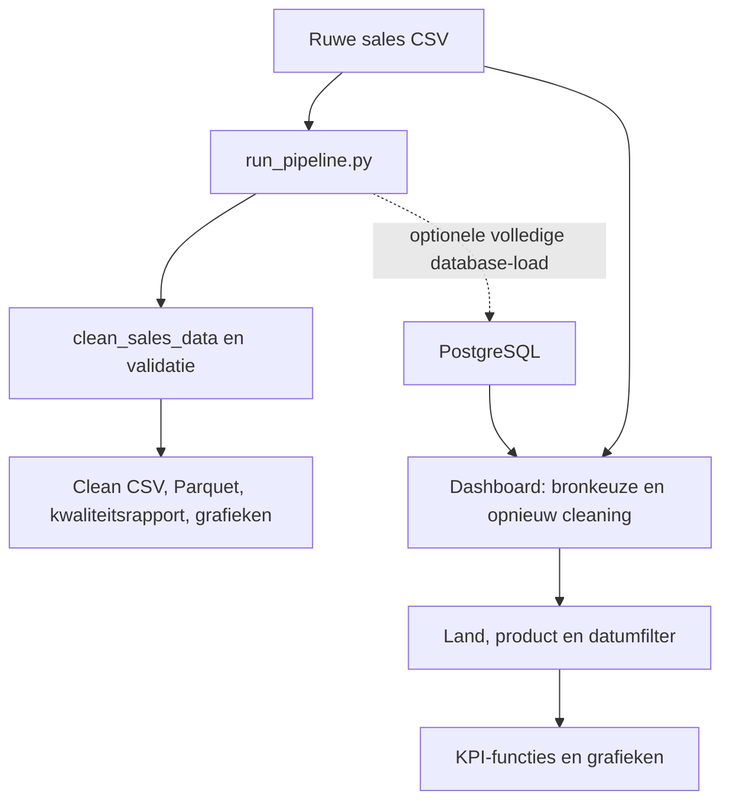

# Van verkoopregel naar zakelijk inzicht

[Leerroute](README.md) · [Oefeningen](oefeningen.md)

## 1. Begin bij de vraag

“Welke landen, producten en klanten leveren omzet en brutowinst op?”
Dit kan commerciële prioriteiten helpen bepalen. De data zijn synthetisch:
een stijgende omzet in deze demo is geen vaststelling over een echt bedrijf.
Het leerdoel is de verwerkings- en redeneerwijze begrijpen.

## 2. Er bestaan twee routes

[run_pipeline.py](../../src/run_pipeline.py) maakt afgeleide bestanden en
rapporten. [dashboard/shared.py](../../dashboard/shared.py) laadt zelfstandig
data. Het dashboard gebruikt PostgreSQL als een database-URL is geconfigureerd;
anders de ruwe CSV. Een onbereikbare geconfigureerde database leidt hier niet
automatisch tot een stille CSV-fallback.

Targets en klantdirectory worden in de dashboardroute uit CSV geladen, ook
wanneer de salesbron PostgreSQL is. Vertel dus niet dat ieder dashboardbestand
uit de database komt.

## 3. Volg één order

Neem een synthetische order met geldige ID en datum, klant `C001`, land
` belgium `, product `shoes`, aantal `2`, prijs `€49,99`, kostprijs `30`.

In [clean_data.py](../../src/clean_data.py) gebeurt dit:

1. Controleer of verplichte kolommen bestaan.
2. Kopieer de invoer, zodat deze functie de originele tabel niet direct wijzigt.
3. Zet de datum om; onleesbare datums worden ontbrekende waarden.
4. Normaliseer landnamen en productnamen.
5. Zet aantal, prijs en kostprijs om naar getallen.
6. Verwijder dubbele order-ID's; de eerste invoerrij blijft over.
7. Verwijder rijen met ontbrekende verplichte waarden of ongeldige rekenwaarden.
8. Bereken omzet, brutowinst en marge; sorteer en valideer.

Het resultaat voor deze order is:

| Veld | Waarde | Verklaring |
|---|---:|---|
| country | Belgium | Spaties weg, mapping naar vaste naam |
| product | Shoes | Gestandaardiseerde hoofdletters |
| revenue | 99,98 | 2 × 49,99 |
| gross_profit | 39,98 | 2 × (49,99 − 30) |
| margin_percent | 39,99 | 39,98 / 99,98 × 100, afgerond |

De parser behandelt eenvoudige komma-/puntnotatie. Een complex bedrag zoals
`1.234,56` is niet vanzelf correct ondersteund. Een onbekend land wordt via de
mapping leeg en kan verdwijnen. Dit zijn belangrijke grenzen van de huidige aanpak.

## 4. Grain is hier een zakelijke aanname

De cleaning en het schema behandelen `order_id` als uniek. Dat betekent in deze
dataset één rij per order. Als een echte webshop meerdere productregels per
order aanlevert, verwijdert deze deduplicatie geldige regels. De analytische
functie `order_totals()` kan wel regels samenvoegen, maar de eerdere cleaning
heeft die dan al weggegooid.

Een geschikte uitbreiding zou een `(order_id, line_id)`-grain vereisen, met
bijbehorende schema-, cleaning- en testwijzigingen. Dit is een leeropdracht, niet
al geïmplementeerd. Ook retouren of verlieslatende orders passen nu niet in de
regel `unit_cost < price` en positieve aantallen. Bespreek de zakelijke definitie
voor je die records als onbruikbaar bestempelt.

## 5. Wat het contract echt bewijst

[validation.py](../../src/validation.py) controleert kolommen, types, toegestane
waarden, unieke order-ID's en grenzen. Het controleert ook dat kostprijs lager
is dan prijs. Het vergelijkt echter niet expliciet voor iedere rij
`revenue == quantity * price` of `gross_profit == quantity * (price - unit_cost)`.

De normale cleaning berekent die velden wel. Een positief maar verkeerd
omzetveld dat rechtstreeks aan de validator wordt gegeven kan binnen het
contract vallen. **Vorm en bereik controleren is iets anders dan alle zakelijke
relaties controleren.** Gebruik daarom handmatig narekenbare voorbeelden.

## 6. KPI's begrijpen

Lees [analysis.py](../../src/analysis.py):

- `calculate_kpis()` telt omzet op, telt unieke orders en klanten en berekent
  gemiddelde orderwaarde via ordertotalen.
- `calculate_profit_kpis()` deelt totale brutowinst door totale omzet voor de
  marge. Het neemt niet het gemiddelde van rijmarges.
- `filter_sales_data()` combineert gekozen landen, producten en datums.
- `previous_period_bounds()` bepaalt een even lange voorgaande periode.
- `calculate_period_comparison()` geeft geen procentuele groei als de vorige
  waarde nul is; dat voorkomt een misleidende deling door nul.

Een rijtelling is alleen een ordertelling zolang grain dat toelaat. Controleer
bij een nieuwe bron de uniciteit vóór je dezelfde KPI-formule hergebruikt.

## 7. Opslag: bestanden en volledige vervanging

De pipeline produceert een gereinigde CSV, Parquet, een kwaliteitsrapport en
grafieken. Parquet is een analytisch kolomformaat; de repo bevat een aparte
DuckDB-queryroute daarop. Dat maakt het nog niet de bron van iedere dashboardpagina.

[load_to_postgres.py](../../src/load_to_postgres.py) doet een volledige lokale
refresh van sales, targets en klanten: tabellen leegmaken en nieuwe gegevens
schrijven binnen één transactie. Dit is geen incrementele upsert. Gebruik zo'n
oefening uitsluitend op de daarvoor bedoelde lokale database. De tabellen moeten
al bestaan volgens de setup uit de README.

## 8. Filters, cache en actualiteit

De dashboarddata worden gecachet. De salescache krijgt onder meer de gewijzigde
tijd van het lokale ruwe CSV-bestand als argument. Een wijziging in PostgreSQL
verandert dat bestandsargument niet vanzelf. Zonder expliciete cacheverversing
kan een nieuwe database-inhoud dus onzichtbaar blijven.

De kwaliteitsrapportpagina leest een door de pipeline geschreven JSON-bestand.
Controleer of dat rapport over dezelfde bronversie gaat als de huidige data.
Een nieuw dashboardresultaat en een oud kwaliteitsrapport kunnen naast elkaar bestaan.

## 9. Segmentatie en voorspellen

RFM staat voor **recency** (hoe recent), **frequency** (hoe vaak) en **monetary**
(hoeveel omzet). De repo heeft zowel regelgebaseerde segmenten als K-Means-clusters.
In [segmentation.py](../../src/segmentation.py) worden de drie variabelen geschaald
zodat eurobedragen de afstanden niet vanzelf domineren. Clusternummers hebben
geen natuurlijke rangorde; de code geeft namen op basis van profielrangschikking.
Die namen bewijzen geen werkelijk klantgedrag of oorzaak.

[forecasting.py](../../src/forecasting.py) vergelijkt Holt en Random Forest op
een latere holdoutperiode. MAE is gemiddelde absolute fout; RMSE weegt grote
missers zwaarder door eerst te kwadrateren. De toekomstgrafiek gebruikt de
Holt-functie; de modelvergelijking is geen automatische keuze van het beste model
voor alle toekomstvoorspellingen.

Verder onderzoek: ontbrekende maanden worden niet vanzelf een complete
maandkalender, synthetische patronen maken het probleem gemakkelijker en meerdere
testperioden plus een eenvoudige baseline zouden meer bewijs geven.

## 10. Een fout onderzoeken

Symptoom: “Omzet is dubbel zo hoog.” Werk van definitie naar bron:

1. Vergelijk dezelfde periode, filters en bron.
2. Controleer rijtelling, unieke order-ID's en omzet vóór en na een join.
3. Controleer of een dimensie meermaals dezelfde sleutel bevat.
4. Controleer cleaning, database-refresh en cache.
5. Maak drie voorbeeldorders en reken het verwachte antwoord na.
6. Herstel de oorzaak en voeg een controle op die oorzaak toe.

Een algemene `drop_duplicates()` toevoegen zonder grain te begrijpen kan geldige
verkoop verbergen. Begin bij de betekenis van de records.

## 11. Je project eerlijk uitleggen

“Ik heb een analyseproject met synthetische salesdata. De code normaliseert en
valideert data, berekent KPI's en toont analyses. Ik kan een order door de functies
volgen. De huidige dataset gaat uit van één rij per order; echte orderregels,
retouren en productiebeheer vragen aanvullende keuzes.”

Gebruik dit als structuur, niet als uit het hoofd geleerde claim. Laat je eigen
rekensom en een onderzochte beperking zien.
